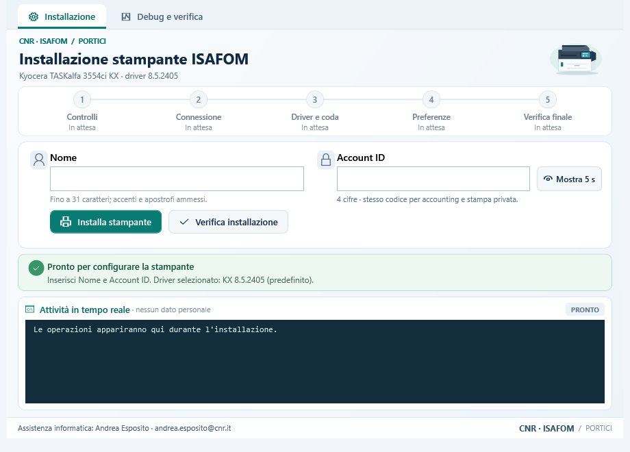

# Installazione stampante ISAFOM

Tool Windows in italiano per configurare la **Kyocera TASKalfa 3554ci KX** della sede **CNR-ISAFOM di Portici**. L'utente inserisce Nome e Account ID; il programma prepara driver e coda, applica le preferenze e le rilegge per verificarle.

**Autore e assistenza:** Andrea Esposito — [andrea.esposito@cnr.it](mailto:andrea.esposito@cnr.it).



**Versione: 0.2.7-rc1, candidata al collaudo.** La rimozione forzata è stata verificata con inventari simulati e anteprima reale in sola lettura; il ciclo completo di applicazione dei campi e rimozione ordinaria è stato eseguito sulla precedente 0.2.6. Stampa fisica, rilascio tramite PIN e altre prove restano [da completare](VALIDATION.md).

## Da dove iniziare

| A chi serve | Documento |
| --- | --- |
| Utilizzatore della stampante | [Guida utente in italiano](docs/GUIDA_UTENTE.md) |
| Amministratore e assistenza | [Guida amministratore](docs/GUIDA_AMMINISTRATORE.md) |
| Chi vuole compilare il programma | [Compilazione e preparazione driver](BUILD.md) |
| Chi deve raccogliere/confrontare impostazioni | [Diagnostica ed estrattore](docs/DIAGNOSTICA.md) |
| Chi deve modificare il codice | [Architettura](docs/ARCHITETTURA.md) e [mappa risorse](FILELIST.md) |
| Risultati e limiti dei test | [Validazione](VALIDATION.md) |
| Licenze e distribuzione | [Componenti di terze parti](THIRD_PARTY_NOTICES.md) |

## Funzioni

- Windows **10 e 11 x64 Intel/AMD**; ARM64 e Windows 32 bit non supportati.
- **KX 8.5.2405 predefinito**, **KX 8.7.0917 facoltativo** da Debug e verifica.
- Configura Nome utente, Job Accounting con ID specifico, stampa privata con lo stesso codice e bianco e nero predefinito.
- Nome fino a 31 caratteri; Account ID di **quattro cifre**, mantenendo gli zeri iniziali. Il limite comune di quattro cifre è quello della stampa privata nel driver collaudato.
- Riutilizza il driver della versione corretta: ripetere l'installazione aggiorna Nome e ID senza reinstallarlo.
- Log scorrevole nella schermata principale, roadmap in cinque fasi, verifica finale e scheda tecnica.
- Rimozione ordinaria o forzata selettiva: elenco aggiornabile, checkbox vuote, conferma delle sole code scelte, protezione della predefinita e conservazione delle risorse condivise; esiti individuali con residui.
- Nessuna stampa di prova automatica e nessuna modifica esplicita della stampante predefinita.

## Ottenere il programma

Questo repository contiene **sorgenti, test, icone, configurazione, strumenti e documentazione**, senza dati raccolti dai PC. **Non contiene i driver Kyocera né l'EXE che li incorpora.** La clausola d) delle licenze fornite con entrambi i driver esclude la pubblicazione del software su siti accessibili al pubblico. Leggere [le istruzioni driver](driver/README.md).

Per costruire l'EXE, procurarsi gli archivi ufficiali esatti e seguire [BUILD.md](BUILD.md). L'eseguibile risultante è autonomo: sul PC dell'utilizzatore non servono SDK, Python o un'installazione separata di .NET. La sua distribuzione va effettuata nel rispetto delle condizioni dei componenti incorporati.

Per ottenere i sorgenti: pulsante **Code → Download ZIP**, oppure:

```powershell
git clone https://github.com/antrea/ISAFOM-Printer-Installer.git
cd ISAFOM-Printer-Installer
```

La procedura manuale di riferimento è la [guida pubblica ISAFOM](https://isafom.cnr.it/stampante-taskalfa-3554ci-kx-portici/). I parametri di rete presenti nel progetto sono quelli pubblicati nella guida; nessun Account ID personale è incluso.

## Riservatezza e stato pubblico

Il codice personale non va inserito nelle issue, nei log allegati, nei file di configurazione o nei commit. Il programma confronta i dati in memoria e scrive log filtrati; il driver conserva necessariamente le proprie impostazioni. Questo non costituisce una garanzia di protezione contro un amministratore del PC o software malevolo.

Il repository è pubblico; non è stata scelta una licenza open source per il codice originale. Vedere [LICENSE.md](LICENSE.md). I marchi CNR, ISAFOM, Kyocera, Microsoft e .NET appartengono ai rispettivi titolari; questo progetto non è un prodotto ufficiale Kyocera.
